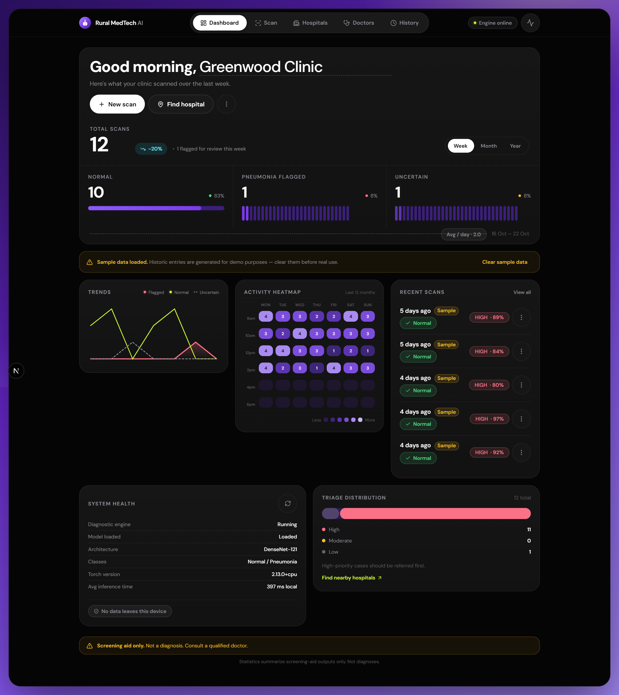
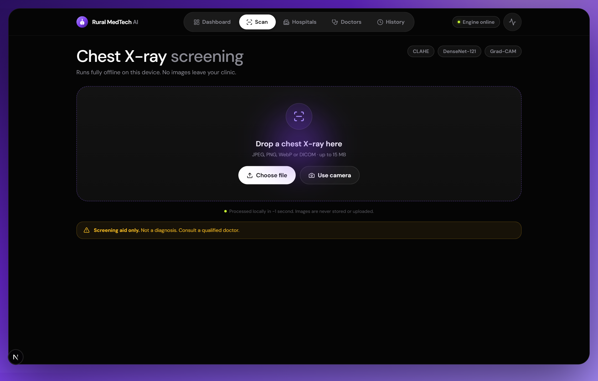
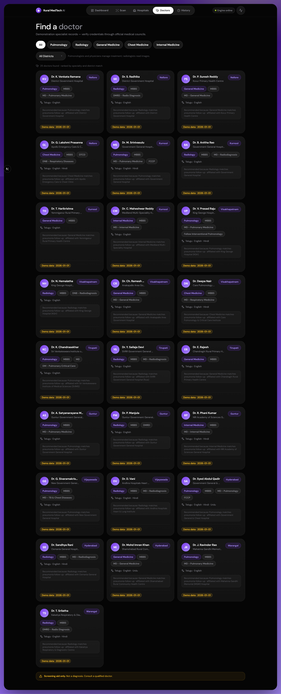
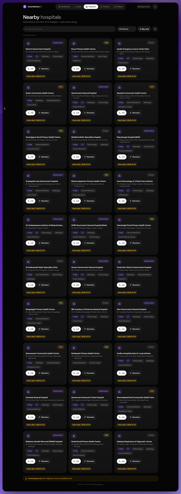
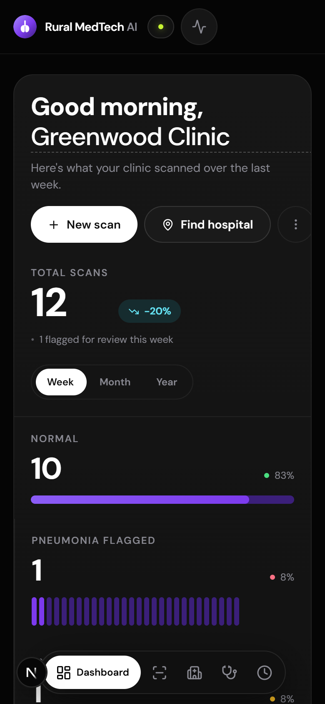

# Rural MedTech AI — Chest X-Ray Screening Platform

> **Screening assistance tool only. Not a medical diagnosis device. Always obtain professional radiological review.**

An offline-capable, AI-powered chest X-ray analysis system designed for rural and low-resource healthcare settings. Runs entirely on your local machine — no patient data is sent to external servers.

---

## Screenshots

| Offline analytics dashboard | Scan — upload & analyze |
|:---:|:---:|
|  |  |
| **Doctors directory** | **Hospitals directory** |
|  |  |
| **Analysis history** | **Dashboard (mobile)** |
|  |  |

---

## Architecture

```
rural-medtech/
├── backend/          # FastAPI + PyTorch (Python 3.14)
│   ├── main.py       # API server, inference engine, Grad-CAM
│   ├── data/         # Local hospital & doctor directory (JSON)
│   ├── models/       # Trained model checkpoint (.pth)
│   └── train_indiana.py  # Training script (Indiana Univ. dataset)
├── dataset/          # Indiana University Chest X-Ray Collection
│   ├── images/       # 7,470 PNG chest X-rays
│   ├── indiana_projections.csv
│   └── indiana_reports.csv
└── frontend/         # Next.js 16 PWA (TypeScript + Tailwind v4)
    ├── app/
    │   ├── page.tsx           # Main scan / upload page
    │   ├── hospitals/page.tsx # Hospital finder
    │   ├── doctors/page.tsx   # Doctor finder
    │   └── history/page.tsx   # Analysis history
    └── lib/
        ├── api.ts    # Typed API client
        └── types.ts  # TypeScript interfaces
```

**Stack:**
- **Frontend:** Next.js 16, React 19, Tailwind CSS v4, TypeScript
- **Backend:** FastAPI, Uvicorn (Python 3.14)
- **ML:** PyTorch 2.13, DenseNet-121 fine-tuned on Indiana University Chest X-Ray dataset
- **Preprocessing:** CLAHE (OpenCV 5) + ImageNet normalization
- **Explainability:** Grad-CAM on `denseblock4.denselayer16.conv2`
- **Dataset:** Indiana University Chest X-Ray Collection (3,818 frontal images)

---

## Prerequisites

- Python 3.14 (virtual environment at `project 110/.venv/`)
- Node.js 20+ (`node` and `npm` accessible)
- 4 GB RAM minimum (model runs on CPU, ~1–2 seconds per inference)
- No internet required after initial setup

---

## Quick Start (Windows PowerShell)

### Start Both Servers Together

```powershell
# From frontend directory:
cd "project 110\rural-medtech\frontend"
node "C:\Program Files\nodejs\node_modules\npm\bin\npm-cli.js" run dev:all
```

Open **http://localhost:3000** in your browser.

### Start Separately (if needed)

**Backend:**
```powershell
cd "project 110\rural-medtech\backend"
& "..\..\..\.venv\Scripts\python.exe" -m uvicorn main:app --host 127.0.0.1 --port 8000 --reload
```

**Frontend:**
```powershell
cd "project 110\rural-medtech\frontend"
node "C:\Program Files\nodejs\node_modules\npm\bin\npm-cli.js" run dev
```

---

## API Endpoints

| Method | Endpoint | Description |
|--------|----------|-------------|
| GET | `/health` | Server liveness check |
| GET | `/model-status` | Model availability, architecture, classes |
| POST | `/analyze-xray` | Upload chest X-ray → prediction + Grad-CAM |
| GET | `/hospitals` | Search hospital directory (`?q=&district=`) |
| GET | `/doctors` | Search doctor directory (`?specialty=&district=`) |

### Analyze X-Ray Request
```
POST /analyze-xray
Content-Type: multipart/form-data
Body: file=<chest_x_ray.jpg>
```

### Analyze X-Ray Response
```json
{
  "status": "success",
  "prediction": "Normal",
  "model_score": 0.7834,
  "is_uncertain": false,
  "risk_level": "Low Priority (Routine)",
  "heatmap_base64": "data:image/png;base64,..."
}
```

---

## Model

- **Architecture:** DenseNet-121 with 2-class linear head (Normal / Pneumonia)
- **Dataset:** Indiana University Chest X-Ray Collection
  - 3,818 frontal chest X-rays
  - 1,387 Normal, ~2,431 Abnormal
  - 80/20 stratified train/val split
- **Training:** 3 epochs, classifier-only fine-tuning, Focal Loss (α=0.25, γ=2.0)
- **Reported validation accuracy:** ~68%
- **Checkpoint:** `backend/models/densenet121_pneumonia.pth` (28.4 MB)
- **Preprocessing:** CLAHE → resize 224×224 → grayscale→RGB → ImageNet normalize
- **Uncertainty threshold:** predictions below 55% softmax confidence are marked inconclusive

---

## Running the Training Script

```powershell
cd "project 110\rural-medtech\backend"
& "..\..\..\.venv\Scripts\python.exe" train_indiana.py
```

Requires dataset CSVs and images in `../dataset/`.

---

## Running the Evaluation Script

```powershell
cd "project 110\rural-medtech\backend"
& "..\..\..\.venv\Scripts\python.exe" evaluate_model.py
```

Outputs metrics to `docs/MODEL_EVALUATION.md`.

---

## Deploy (single service, free tier)

The whole platform deploys as **one** Render web service: the Python engine serves both the AI API and the Next.js UI (exported static bundle) from a single origin.

[](https://render.com/deploy?repo=https://github.com/FLASH11025/rural-medtech-ai)

1. Click the button, sign in with GitHub, confirm — `render.yaml` does the rest (installs Python deps, builds the frontend, starts `uvicorn backend.main:app`).
2. First build takes ~5–10 minutes (CPU-only PyTorch wheels + Next build).
3. Your service URL, e.g. `https://rural-medtech-ai.onrender.com`, serves the app at `/` and the health check at `/health`.

**Custom domain (optional):** buy any domain (or get a free `.me` via the GitHub Student Pack), then in the Render dashboard → your service → Settings → Add Custom Domain, and paste the CNAME record Render shows at your registrar. HTTPS is issued automatically.

> **Free-tier notes:** Render's free plan sleeps after ~15 min idle — the first scan after a break takes ~1 min to wake the engine. Free containers have 512 MB RAM, so the deployed engine runs an int8 dynamic-quantized model (`QUANTIZE_CPU=1`) — predictions match the float checkpoint (validated: score drift ~0.0002), but Grad-CAM heatmaps are only available in local runs because quantized operators are non-differentiable. For the full experience (heatmaps, guaranteed offline), run locally as described in Quick Start.

---

## Privacy & Security

- All inference is **strictly local** — no image data leaves the machine
- Images are not stored after analysis (session-only)
- History page uses browser `localStorage` — no images, only result summaries
- Deleting records from the History page removes them permanently
- Location access (Hospital Finder) is optional and permission-gated

---

## Known Limitations

1. **Dataset label quality:** Labels are derived from free-text radiology report `Problems` field via keyword matching. "No Indexing" entries (91 cases) are treated as abnormal — this may introduce noise.
2. **Patient-level split:** The current train/val split is image-level, not patient-level. If multiple images per patient exist, there is a theoretical data leakage risk.
3. **Validation accuracy ~68%:** The model is a screening assistance tool, not a diagnostic device. It has not been validated in a clinical setting.
4. **Preprocessing note:** Training used PIL Grayscale transforms without CLAHE. Inference uses CLAHE preprocessing. This distribution gap may affect performance.
5. **CPU-only:** No GPU acceleration — inference takes 1–3 seconds on modern CPU.
6. **No DICOM PII stripping:** DICOM files are accepted but patient metadata is not automatically stripped. Do not upload identifiable DICOM files in production without proper de-identification.

---

## Medical Disclaimer

This application is a **research and development prototype**. It has not received regulatory clearance (CE, FDA, CDSCO, or equivalent) as a medical device. It must not be used for clinical decision-making without independent radiological review.

**The AI result alone must never drive treatment decisions.**

---

## Links

- **Live app:** [bradford-lived-survival-requesting.trycloudflare.com](https://bradford-lived-survival-requesting.trycloudflare.com) *(runs on the developer's machine — active while the demo session is up)*
- **GitHub repository:** [github.com/FLASH11025/rural-medtech-ai](https://github.com/FLASH11025/rural-medtech-ai)
- **Literature review:** [docs/literature-review.md](docs/literature-review.md)
- **Model evaluation report:** [docs/MODEL_EVALUATION.md](docs/MODEL_EVALUATION.md)
