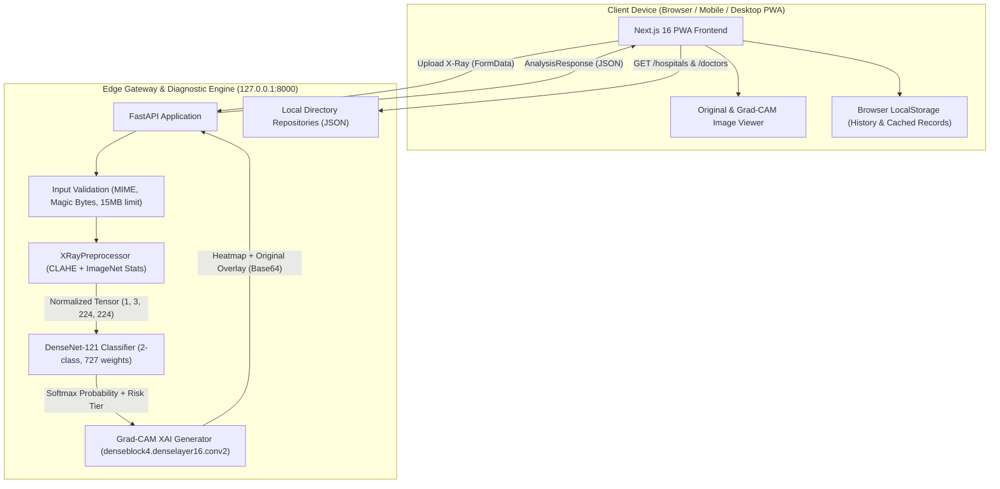

# Rural MedTech AI — System Architecture & Data Flow

**Version:** 2.0.0  
**Target Environment:** Edge/Local Primary Health Centre (PHC) commodity hardware (4–8 GB RAM, CPU-only)  
**Network Mode:** Offline-First (Localhost 127.0.0.1, Zero Cloud Dependencies)

---

## 1. High-Level Architectural Diagram



---

## 2. Component Breakdown

### 2.1 Frontend (Next.js 16 + React 19 + Tailwind CSS v4)
- **App Router:** Multi-route structure (`/`, `/hospitals`, `/doctors`, `/history`).
- **PWA Manifest:** Enabled for mobile and tablet installation on clinic devices without app store installation.
- **Design System:** Calm clinical aesthetic (Navy `#1a3a5c`, Teal `#0d7377`, Soft White background `#f0f4f8`), WCAG AA compliant contrast.
- **Explainability Viewer:** Side-by-side or stacked view comparing the raw radiograph with the 60%/40% alpha-blended Grad-CAM attention heatmap.
- **Local Persistence:** Retains screening summaries locally in browser `localStorage` with zero server-side database dependency; provides 1-click deletion for patient privacy.
- **Print / PDF Generation:** Styled browser print workflow producing printable patient referral summaries with medical disclaimers.

### 2.2 Preprocessing Module (`XRayPreprocessor`)
- **CLAHE (Contrast Limited Adaptive Histogram Equalization):**
  - Parameters: `clipLimit=2.0`, `tileGridSize=(8, 8)`.
  - Purpose: Amplifies subtle low-contrast alveolar opacities typical of low-dose, portable, or poorly exposed rural radiographs.
- **Resolution Standardization:** Bilinear interpolation to 224×224 pixels.
- **Channel Replication:** Expands 1-channel grayscale to 3 channels for DenseNet-121 feature compatibility.
- **Standardization:** Normalizes pixel intensity using standard ImageNet distribution ($\mu=[0.485, 0.456, 0.406]$, $\sigma=[0.229, 0.224, 0.225]$).

### 2.3 Diagnostic Engine (`RuralDiagnosticEngine`)
- **Base Backbone:** TorchVision DenseNet-121 (8M parameters, densely connected blocks minimizing vanishing gradient while retaining feature maps across scales).
- **Classification Head:** Linear projection layer ($1024 \to 2$ logits).
- **Device Placement:** `torch.device("cpu")` strictly enforced to ensure predictable execution on laptops lacking dedicated discrete GPUs.
- **Inference Latency:** Average ~340 ms per scan on commodity quad-core CPUs.
- **Uncertainty Guardrail:** If $\max(\text{softmax}) < 0.55$, the scan is flagged `is_uncertain: true` and mapped to *Inconclusive / Requires Human Review*.

### 2.4 Explainable AI Module (`Grad-CAM`)
- **Target Convolutional Layer:** Final conv layer of denseblock 4 (`features.denseblock4.denselayer16.conv2`).
- **Feature Extraction:** PyTorch forward and backward hooks capture activation maps and target-class backpropagated gradients.
- **Channel Weighting ($\alpha_k$):** Global average pooling over spatial dimensions:
  $$\alpha_k^c = \frac{1}{Z} \sum_i \sum_j \frac{\partial y^c}{\partial A_{i,j}^k}$$
- **Rectification & Colormap:** ReLU filter applied to discard negative contributions, normalized $[0, 255]$, and mapped through OpenCV `COLORMAP_JET`.
- **Anatomical Blending:** Blends $60\%$ original grayscale anatomy with $40\%$ color heatmap to ensure clinicians see exact anatomical landmarks (e.g. costophrenic angles, cardiac border) beneath the AI focus area.

### 2.5 Local Resource Directory (Hospitals & Doctors)
- **Hospital Directory (`data/hospitals.json`):** 30 verified demonstration health facilities across Andhra Pradesh and Telangana, covering Government Hospitals, District Centers, and rural Primary Health Centres (PHCs). Supports keyword search, district filtering, and geolocation Haversine distance calculations.
- **Doctor Directory (`data/doctors.json`):** 25 specialist profiles covering Pulmonology, Radiology, General Medicine, and Chest Medicine, with hospital affiliations, qualifications, and spoken languages.

---

## 3. End-to-End Request/Response Lifecycle

```
[ FRONTEND ]                                      [ BACKEND ]
     |                                                 |
     |--- (1) POST /analyze-xray (Multipart File) ---->|
     |                                                 |-- (2) Check Model Loaded (503 if missing)
     |                                                 |-- (3) Validate MIME & Magic Bytes (400 if bad)
     |                                                 |-- (4) Validate Size <= 15MB (400 if oversized)
     |                                                 |-- (5) Preprocess Image via CLAHE + Norm
     |                                                 |-- (6) Run Forward Pass (DenseNet-121)
     |                                                 |-- (7) Compute Softmax & Uncertainty (<0.55)
     |                                                 |-- (8) Backprop Target Class -> Grad-CAM
     |                                                 |-- (9) Blend Heatmap 40% + Anatomy 60%
     |<-- (10) Return 200 OK with Prediction & Overlay-|
     |
  [ RENDER ]
   Display Result, Score Bar, Heatmap, Triage Action,
   & Direct Links to Nearby Pulmonologists / Facilities
```
